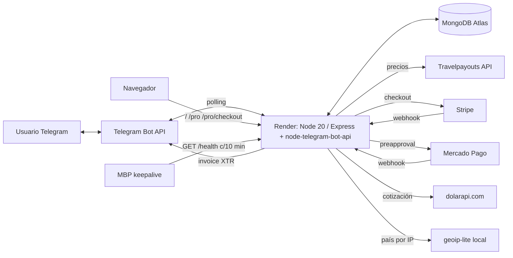

# flight-alert-public

Buscador y alertas de vuelos baratos **Argentina → Europa**, por Telegram (@flightalertpro_bot) y una web pública. Única fuente de precios: Travelpayouts (caché de Aviasales). El bot privado de Emilio no vive en este repo.

## Funciones

- **/buscar**: precio más barato en caché para una ruta y fecha, con "visto hace X h" y un deep link a Aviasales con el marker de afiliado (mismas fechas, moneda EUR y mercado).
- **/nueva_alerta**, **/mis_alertas**: rutas guardadas; el **informe diario** sale a las 21:00 (hora Argentina).
- **/informe**: último informe. **/pro**: planes y pago.
- Web: landing (`/`), página Pro (`/pro`), checkout (`POST /pro/checkout`), vuelta al chat (`/pro/listo`).
- Cobertura: orígenes EZE, BUE, COR, MDQ, ROS × 31 destinos europeos (`src/config/airports.js`).

## Planes

| Plan | Qué incluye | Precio |
|---|---|---|
| Free | 10 búsquedas por mes (se renuevan el 1° del mes, hora ART); alertas con 7 días de prueba por dispositivo | 0 |
| Pro (30 días) | Búsquedas sin límite (tope anti-abuso 10/min y 60/día), alerta instantánea cuando el precio llega a tu techo e informe de las 21:00 ART | €4,50 IVA incluido (UE, Stripe) · US$5 (resto, Stripe) · ARS al dólar oficial (Argentina, Mercado Pago) · 250 ⭐ Telegram Stars |

Los IDs de Telegram en `OWNER_TELEGRAM_IDS` no tienen tope.

## Arquitectura



- `src/app.js`: Express (`trust proxy` 1, límite por IP), webhooks, scheduler interno con lock en Mongo y recuperación (21:00 informe, cada hora vencimientos, 10:00 cotización, alerta instantánea cada 3 h).
- `src/bot/`: bot (node-telegram-bot-api, polling). `src/providers/travelpayouts.js`: precios. `src/services/payments/`: Stripe, MP, Stars. `src/services/fx.js`: dolarapi. `src/services/country.js`: geoip-lite + elección de moneda.
- Flags `FEATURE_*` (on/1/true/yes) y `PUBLIC_KILL_SWITCH=on`.

## Correr local

```bash
npm ci
# exportar las variables de render.yaml; sin valores reales de producción
npm start              # sin variables de producto sólo responde /health
npm test               # jest
```

Sin `TELEGRAM_BOT_TOKEN` no hay polling. No usar el token de producción en local: dos procesos con polling se pisan.

## Deploy

Render (servicio `flight-alert-public`, Docker, Frankfurt, plan Free) despliega solo con cada merge a `main`. Variables en Render > Environment. Detalle operativo: `docs/OPERATIONS.md`. Cobros reales: `docs/GO_LIVE.md`.

El chequeo de cobertura (`node scripts/coverageCheck.js`) se corre a mano.
