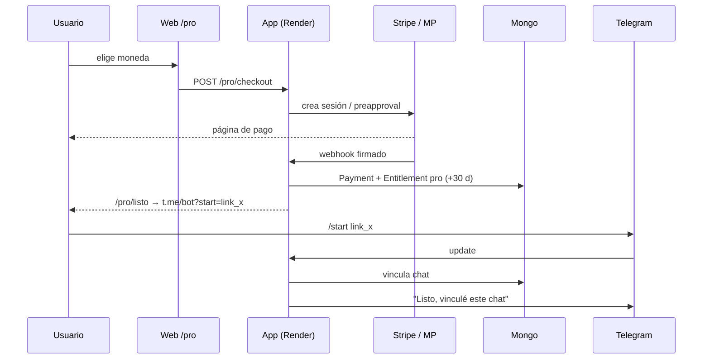
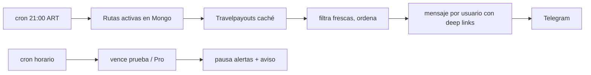

# Operaciones: flight-alert-public

Sin valores secretos. Los datos de cuentas son los observados en los dashboards el 21/10/2026; donde no se verificó dice **unknown**.

## 1. Inventario de servicios

| Servicio | Cuenta / login | 2FA | Identificación | Dashboard | Variables | Dónde rotar | Si falta |
|---|---|---|---|---|---|---|---|
| **Render** | emilioranucoli@hotmail.com (método de login: unknown) | unknown | Workspace "My Workspace", proyecto `flight-alert-public`, servicio `srv-dbbt3svf3r2c73bo6o6g`, Docker, Frankfurt, plan **Free**; repo GitHub `RanuK12/flight-alert-public` rama `main` | https://dashboard.render.com/web/srv-dbbt3svf3r2c73bo6o6g | todas (Environment) | Render > Environment > Edit > Save only > Manual Deploy | No hay servicio |
| **UptimeRobot** | `emilio@ranuk.dev` | Google | Monitor HTTP `flight-alert-public health` sobre https://flight-alert-public.onrender.com/health, cada 5 min | https://dashboard.uptimerobot.com/monitors | la de Google | n/a | Mantiene despierto el plan Free y avisa por email a `emilio@ranuk.dev` cuando el monitor pasa a Down (sin respuesta 2xx) y cuando vuelve a Up |
| **MongoDB Atlas** | unknown | unknown | org/proyecto/cluster: unknown (no observados en esta sesión) | https://cloud.mongodb.com | `MONGODB_URI` | Atlas > Database Access > usuario > Edit password; Network Access para IPs | No arranca / sin usuarios, cuotas ni pagos |
| **Telegram / BotFather** | cuenta de Telegram de Emilio (número/usuario dueño: unknown) | unknown | `@flightalertpro_bot` | BotFather `/mybots` | `TELEGRAM_BOT_TOKEN`, `TELEGRAM_BOT_USERNAME` | BotFather > /mybots > API Token > Revoke | Bot mudo; Stars no funciona; links de vuelta al chat rotos |
| **Travelpayouts** | tanquer9@gmail.com (login: unknown) | unknown | marker **793462**; programa Aviasales | https://app.travelpayouts.com | `TRAVELPAYOUTS_TOKEN`, `TRAVELPAYOUTS_MARKER`, (opcional `TRAVELPAYOUTS_MARKET`) | Profile > API token | Búsquedas vacías; sin marker no hay comisión |
| **Stripe (live)** | cuenta "Ranuk-IT-Solutions" (IT); email/login: unknown | unknown | producto `prod_VTgn4uyWUsgzqJ`; precio EUR €4,50/mes inclusive `price_1USjQH2OfOTndIPlfZg7rjFx` (`STRIPE_PRICE_EUR`), precio USD 5,00/mes `price_1USjQH2OfOTndIPly4qsla08` (`STRIPE_PRICE_USD`) | https://dashboard.stripe.com | `STRIPE_SECRET_KEY`, `STRIPE_WEBHOOK_SECRET_LIVE`, `STRIPE_PRICE_EUR`, `STRIPE_PRICE_USD`, `STRIPE_TAX_ENABLED` | Developers > API keys (roll); Webhooks > endpoint > Roll secret | Sin checkout EUR/USD; webhooks rechazados → Pro no se activa |
| **Stripe Tax** | misma cuenta | — | registro IVA Italia/OSS; Price EUR `tax_behavior=inclusive` | https://dashboard.stripe.com/settings/tax | — | — | Checkout EUR no calcula IVA |
| **Mercado Pago** | email/login: unknown | unknown | app id en el panel, no en el repo | https://www.mercadopago.com.ar/developers/panel/app | `MP_ACCESS_TOKEN`, `MP_WEBHOOK_SECRET` | Tus integraciones > app > Credenciales de producción / Webhooks > firma | Sin pago en ARS |
| **dolarapi.com** | sin cuenta (API pública) | n/a | `GET https://dolarapi.com/v1/dolares/oficial` | — | — | — | Se usa la última cotización guardada; precio ARS desactualizado |
| **geoip-lite** | librería local | n/a | base incluida en el paquete npm | — | — | actualizar dependencia | País mal detectado → moneda por defecto |

### Webhooks

| Proveedor | URL | Eventos |
|---|---|---|
| Stripe (live) | `{PUBLIC_BASE_URL}/webhooks/stripe` | `checkout.session.completed`, `invoice.paid`, `invoice.payment_failed`, `customer.subscription.deleted` |
| Mercado Pago | `{PUBLIC_BASE_URL}/webhooks/mp` | `payment`, `subscription_preapproval` |

## 2. Variables de entorno

| Variable | Para qué | Secreta | Origen |
|---|---|---|---|
| `TELEGRAM_BOT_TOKEN` | API del bot | sí | BotFather |
| `TELEGRAM_BOT_USERNAME` | links `t.me/...` | no | BotFather |
| `TELEGRAM_POLLING` | forzar/apagar polling | no | manual |
| `MONGODB_URI` | base de datos | sí | Atlas > Connect |
| `TRAVELPAYOUTS_TOKEN` | API de precios | sí | Travelpayouts > Profile |
| `TRAVELPAYOUTS_MARKER` | afiliado en deep links | no | Travelpayouts (793462) |
| `TRAVELPAYOUTS_MARKET` | mercado del deep link (opcional, PR #5) | no | manual |
| `STRIPE_SECRET_KEY` | API Stripe | sí | Stripe > API keys |
| `STRIPE_WEBHOOK_SECRET` | firma webhook test | sí | Stripe (test) |
| `STRIPE_WEBHOOK_SECRET_LIVE` | firma webhook live | sí | Stripe > Webhooks |
| `STRIPE_PRICE_EUR` / `STRIPE_PRICE_USD` | precios mensuales | no | Stripe > Productos |
| `STRIPE_TAX_ENABLED` | Tax en USD | no | manual |
| `MP_ACCESS_TOKEN` | API Mercado Pago | sí | MP > Credenciales |
| `MP_WEBHOOK_SECRET` | firma webhook MP | sí | MP > Webhooks |
| `STARS_PAYLOAD_SECRET` | firma del payload de Stars | sí | generado (aleatorio 32 bytes) |
| `DEVICE_COOKIE_SECRET` | firma de cookie de prueba por dispositivo | sí | generado |
| `PAYMENTS_MODE` | `test` / `live` | no | manual |
| `PUBLIC_BASE_URL` | origen público (sin `/` final) | no | Render URL |
| `OWNER_TELEGRAM_IDS` | dueños: sin cuota, avisos de cobro | no | Telegram |
| `PUBLIC_KILL_SWITCH` | `on` = mantenimiento | no | manual |
| `FEATURE_SEARCH`, `FEATURE_ALERTS`, `FEATURE_PAYMENTS_STARS`, `FEATURE_PAYMENTS_MP`, `FEATURE_PAYMENTS_STRIPE` | flags (hoy en `true`) | no | manual |
| `FEATURE_CHANNELS` | fase 2 (apagado) | no | manual |
| `ADMIN_TOKEN` | bearer de `/admin/*` (≥32 caracteres; sin él `/admin` da 404) | sí | `openssl rand -hex 32` en el MBP → llavero `flight-alert-public/ADMIN_TOKEN` |
| `FEATURE_INSTANT_ALERTS` | kill switch de la alerta instantánea Pro | no | manual |
| `PRO_SEARCH_PER_MIN` / `PRO_SEARCH_PER_DAY` | tope anti-abuso de Pro (10 / 60 por defecto) | no | manual |
| `INSTANT_ALERTS_EVERY_HOURS` | cada cuántas horas corre la alerta instantánea (3) | no | manual |
| `INSTANT_ALERTS_COOLDOWN_HOURS` | cooldown por alerta (12) | no | manual |
| `INSTANT_ALERTS_MAX_PER_DAY` | avisos instantáneos por usuario por día (5) | no | manual |
| `DIGEST_GRACE_HOURS` | margen para recuperar el informe de las 21:00 si el servicio dormía (3) | no | manual |
| `PORT`, `NODE_ENV` | runtime | no | Render |

## 3. Respaldo de secretos

Llavero **login** del MBP, contraseñas genéricas, servicio `flight-alert-public/<VAR>`, cuenta `emilio`. Guardadas el 21/10/2026:
`TELEGRAM_BOT_TOKEN`, `MONGODB_URI`, `TRAVELPAYOUTS_TOKEN`, `STRIPE_SECRET_KEY`, `STRIPE_WEBHOOK_SECRET_LIVE`, `MP_ACCESS_TOKEN`, `MP_WEBHOOK_SECRET`, `DEVICE_COOKIE_SECRET`, `STARS_PAYLOAD_SECRET`.
Al rotar un secreto, actualizar Render **y** el llavero (`security add-generic-password -U ...` leyendo de stdin, nunca en la línea de comandos).

## 4. Cómo se conecta todo

1. **/start**: Telegram entrega el mensaje; el proceso en Render lo toma por polling (node-telegram-bot-api), Express sólo sirve web y webhooks. El usuario se crea/actualiza en Mongo (`User`, `Entitlement`).
2. **Búsqueda**: `runSearch` verifica flags, anti-spam (10 s), cuota (10/mes, ART) y duplicados de 24 h; pide `/v2/prices/month-matrix` a Travelpayouts en EUR, filtra fecha exacta y frescura ≤7 días. Sólo una búsqueda con resultados descuenta cuota. Respuesta: precio "visto hace X h" + deep link Aviasales `ORIGEN DDMM DESTINO [DDMM] 1` con `marker=793462`, `currency=eur`.
3. **Pago web**: `/pro` (país por geoip-lite + elección) → `POST /pro/checkout` → Stripe Checkout (EUR/USD) o preapproval MP (ARS) → el proveedor llama al webhook → se valida la firma → `activatePro` (idempotente por `provider+ref`, colección `Payment`) → `Entitlement.plan=pro`, `proUntil` +30 d → `/pro/listo` da el link `t.me/<bot>?start=link_<código>` que vincula el chat con el pago → aviso a `OWNER_TELEGRAM_IDS` en live.
4. **Stars**: dentro del bot, invoice XTR de 250 ⭐ con payload firmado (`STARS_PAYLOAD_SECRET`) → `pre_checkout_query` → `successful_payment` → `activatePro`.
5. **ARS**: job de las 10:00 ART consulta dolarapi (oficial, venta), guarda la cotización y ajusta el monto de las suscripciones MP.
6. **Alertas**: rutas en `Route`. Informe 21:00 ART; job horario de vencimientos. **Alerta instantánea (Pro)**: cada `INSTANT_ALERTS_EVERY_HOURS` h agrupa las alertas por ruta+fechas (una consulta a Travelpayouts por grupo) y avisa si el precio está en o debajo del techo, con deep link y "visto hace". Dedupe ruta+precio+fecha, cooldown 12 h por alerta, máx. 5/día por usuario, silencio 00–08 ART (lo retenido sale en la corrida de las 08:00). Kill switch `FEATURE_INSTANT_ALERTS`.
   **Scheduler**: todo corre dentro del proceso de Render (sin cron externo ni MBP). Al arrancar y cada minuto revisa la ventana vigente de cada job; un lease en Mongo (`JobLock`, TTL) evita corridas dobles entre instancias o reinicios, y `lastWindow`/`lastRunAt` en Mongo lo hace idempotente. Si el servicio dormía, al despertar recupera la ventana una vez si sigue dentro del margen (informe 3 h, cotización 12 h, vencimientos 1 h).
   **Planes**: Free 10 búsquedas/mes. Pro búsquedas sin límite con tope anti-abuso 10/min y 60/día. Owner sin tope.
7. **Keepalive y monitoreo**: UptimeRobot (cuenta `emilio@ranuk.dev`, login con Google) pide `https://flight-alert-public.onrender.com/health` cada 5 min. Eso evita que el plan Free duerma y, si la respuesta no es 2xx, manda un email a `emilio@ranuk.dev` (y otro cuando se recupera). No depende del MBP. El LaunchAgent viejo `com.ranuk.fap-keepalive` se dio de baja el 22/10/2026; queda solo su log histórico en `~/.rkfap/keepalive.log`.





## 5. API de administración

Todas con `Authorization: Bearer $ADMIN_TOKEN`, comparación en tiempo constante, 30 pedidos/min por IP, `Cache-Control: no-store`. Sin token: 401; sin `ADMIN_TOKEN` en el servidor: 404.

| Método | Ruta | Qué hace |
|---|---|---|
| GET | `/admin/status` | salud, commit (`RENDER_GIT_COMMIT`), versión, usuarios Free/Pro/prueba, pagos de hoy por método (solo conteos) |
| POST | `/admin/kill` `{"state":"on"\|"off"}` | kill switch general, guardado en Mongo (`RuntimeFlag`), sobrevive reinicios |
| POST | `/admin/instant-alerts` `{"state":"on"\|"off"\|"env"}` | override de `FEATURE_INSTANT_ALERTS` (`env` vuelve a la variable) |
| POST | `/admin/price-check` | fuerza la revisión de alerta instantánea (máx. 2 cada 10 min; respeta el silencio 00–08) |
| GET | `/admin/logs?n=200` | últimas líneas del proceso, sin tokens, claves, URIs ni emails |

```bash
TOKEN=$(security find-generic-password -a emilio -s flight-alert-public/ADMIN_TOKEN -w)
curl -s -H "Authorization: Bearer $TOKEN" https://flight-alert-public.onrender.com/admin/status
```

## 6. Runbooks

**Go-live (cobros reales)**: seguir `docs/GO_LIVE.md`. Resumen: claves live en Render, `PAYMENTS_MODE=live`, webhook live con los 4 eventos, Stripe Tax activo, deploy, ver `payments: live` en el log, un pago real mínimo y su reembolso (lo hace Emilio).

**Rollback**: Render > Deploys > deploy anterior > "Rollback", o `git revert` del merge en `main` (redeploy automático). Las variables no se revierten solas.

**Kill switch**: `FEATURE_INSTANT_ALERTS=off` apaga solo la alerta instantánea. `PUBLIC_KILL_SWITCH=on` → el bot contesta "mantenimiento", sin crons. Para apagar una parte: poner en `off` el `FEATURE_*` correspondiente (búsqueda, alertas, Stars, MP, Stripe). Save only + Manual Deploy.

**Reembolsos**: Stripe > Pagos > Reembolsar (y cancelar la suscripción); MP > Actividad > Devolver + cancelar preapproval; Stars: `refundStarPayment` desde la Bot API con el `telegram_payment_charge_id`. Después, bajar el plan (`downgrade`) si corresponde.

**Restaurar el servicio**: crear un Web Service Docker en Render desde `RanuK12/flight-alert-public` (`main`), región Frankfurt, cargar las variables desde el llavero, `PUBLIC_BASE_URL` nuevo, actualizar las URLs de webhook en Stripe y MP, revisar `/health`, y cambiar la URL del monitor de UptimeRobot a la nueva.

**Restaurar la base**: Atlas > cluster > Backup (si el tier lo incluye: unknown) o `mongorestore` desde un `mongodump`. Si el usuario de DB cambia, actualizar `MONGODB_URI` en Render y en el llavero.

## Telegram: webhook en producción

- Con `TELEGRAM_WEBHOOK_SECRET` y `PUBLIC_BASE_URL` el bot no hace polling: al arrancar llama `setWebhook` a `/webhooks/telegram` con `secret_token`, y la ruta rechaza (401) todo update sin el header `X-Telegram-Bot-Api-Secret-Token` correcto.
- Así dos instancias durante un deploy o restart no se pisan (los 409 "terminated by other getUpdates" del 22/10).
- Sin el secreto (local) sigue el polling; `TELEGRAM_POLLING=false` lo apaga.
- Activar: cargar el secreto en Render con "Save only" y después deploy manual. Para volver a polling: borrar la variable y llamar `deleteWebhook`.
